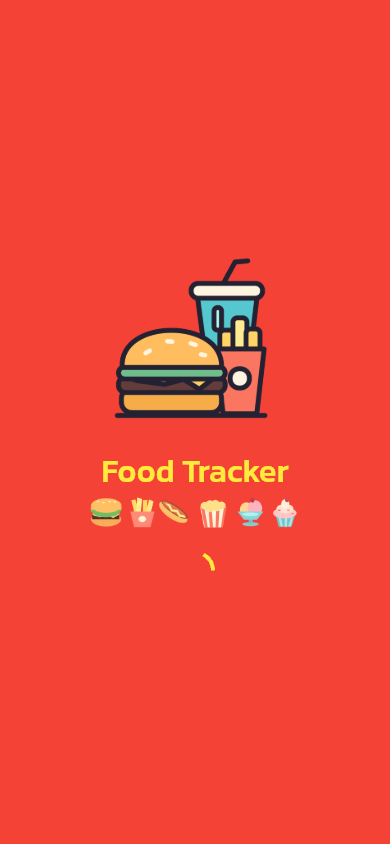
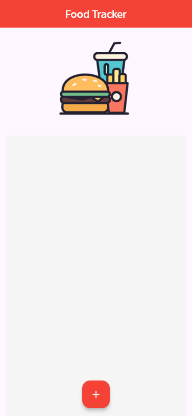
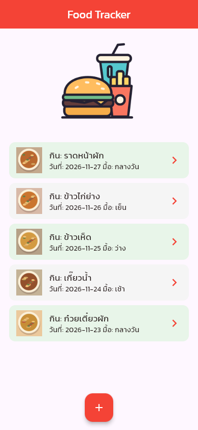
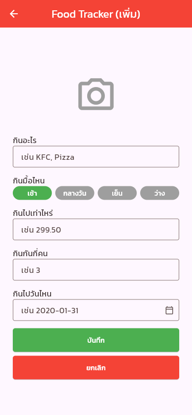
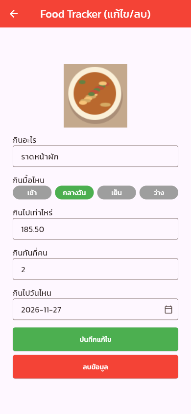
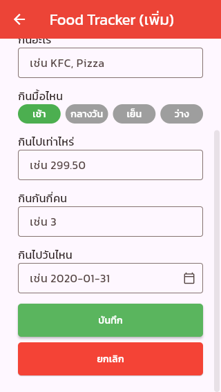
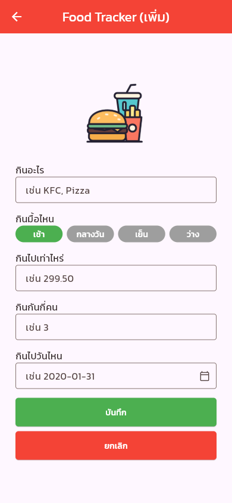

# Food Tracker

Food Tracker เป็นแอปบันทึกมื้ออาหาร ค่าใช้จ่าย และจำนวนคนที่กินด้วยกัน พัฒนาด้วย Flutter และ Dart โดยใช้ Supabase เก็บรายการและรูปถ่าย

## ฟังก์ชันการทำงาน

- ดูรายการเรียงจากวันที่กินล่าสุด พร้อมรูปย่อ ชื่ออาหาร วันที่ และมื้อ
- เพิ่มรายการด้วยมื้อเช้า กลางวัน เย็น หรือว่าง เลือกวันที่จากปฏิทิน และแนบรูปได้ตามต้องการ
- แก้ไขข้อมูลและเปลี่ยนรูป ระบบบันทึกรูปใหม่ก่อนนำไฟล์เดิมออก
- ยืนยันก่อนลบรายการและรูปที่เกี่ยวข้อง หน้ารายการโหลดใหม่เมื่อกลับจากฟอร์ม
- ถ่ายภาพบน Android หรือเลือกไฟล์จากเครื่องบน Web

## ภาพหน้าจอแอปพลิเคชัน

ภาพจาก Food Tracker บน Chrome Headless ใช้รายการและรูปตัวอย่างสังเคราะห์ที่ขนาด 390 × 844 logical pixels

| Splash | รายการว่าง | รายการอาหาร |
| :---: | :---: | :---: |
|  |  |  |

| เพิ่มรายการ | แก้ไขหรือลบ | ฟอร์มบนจอ 320 × 568 |
| :---: | :---: | :---: |
|  |  |  |

## เทคโนโลยีที่ใช้

| ส่วน | เทคโนโลยี |
| --- | --- |
| UI และภาษา | Flutter 3.50.0, Dart 3.14.0, Material UI, Kanit |
| ฐานข้อมูลและรูปภาพ | Supabase PostgreSQL, Data API, Storage และ RLS |
| รับไฟล์และชื่อรูป | Image Picker และ UUID v4 |

## โครงสร้างโปรเจกต์

~~~text
lib/
  main.dart       เริ่มแอปและโหลดการตั้งค่า
  models/         ตรวจข้อมูลและแปลง JSON
  services/       ดึงรายการและจัดการฐานข้อมูลกับไฟล์
  views/          หน้าจอทั้งสี่
  widgets/        ฟอร์มและองค์ประกอบภาพที่ใช้ร่วมกัน
assets/           โลโก้และฟอนต์
docs/             ภาพหน้าจอและ SQL สำหรับตั้งค่า
test/             ชุดทดสอบ Model, Widget และ Supabase
~~~

## การติดตั้งและใช้งาน

1. ติดตั้ง Flutter SDK แล้วรัน `flutter pub get`
2. สร้าง Supabase Project สำหรับทดลอง เปิด Data API ให้เข้าถึง schema `public`
3. สร้าง Storage Bucket ชื่อ `food_tracker_bk` แบบ Public จำกัด 5 MiB ต่อไฟล์ และอนุญาต MIME `image/jpeg`, `image/png`, `image/webp`
4. เปิด [ไฟล์ตั้งค่า SQL](docs/supabase_setup.sql) และรันหนึ่งครั้งใน SQL Editor ของโปรเจกต์ทดลองที่เพิ่งสร้าง ตาราง `food_tracker_tb` มี `id` (UUID), `created_at` (timestamptz), `foodDate`, `foodMeal`, `foodName`, `foodImageUrl` (text), `foodPrice` (float8) และ `foodPerson` (int4) Supabase สร้างรหัสและเวลาให้ รูปเก็บใน Bucket ภายใต้ `foods/`
5. คัดลอก `supabase.example.json` เป็น `.local/supabase.json` แล้วใส่ Project URL และ Publishable Key ของโปรเจกต์ทดลอง เก็บไฟล์นี้ในเครื่องและใช้เพียง Publishable Key
6. รันคำสั่งต่อไปนี้สำหรับ Web หรือระบุ Android device จาก `flutter devices`

~~~sh
flutter run -d chrome --dart-define-from-file=.local/supabase.json
flutter run -d <android-device-id> --dart-define-from-file=.local/supabase.json
~~~

## การทดสอบและข้อจำกัด

~~~sh
flutter analyze
flutter test
flutter test --dart-define=FOOD_TRACKER_LIVE_TEST=true --dart-define-from-file=.local/supabase.json test/live_supabase_test.dart
~~~

ชุดปกติครอบคลุมวันที่และตัวเลข รูปที่ผ่านการถอดรหัส การล้างฟอร์ม และการโหลดรายการหลังเปลี่ยนหน้า ชุด live เปิดแยกและใช้ข้อมูลสังเคราะห์ ตรวจสายงาน CRUD การเปลี่ยนรูป ข้อจำกัดสิทธิ์ และเก็บกวาดเฉพาะข้อมูลของรอบทดสอบ

ผลตรวจผ่าน Flutter Analyze, ชุดปกติ 21 รายการ รวม Image reference regression 14 รายการ และ Supabase live 2 ชุด สร้าง Web และ Android debug APK จาก source รุ่นสุดท้ายแล้ว รอบพัฒนาได้ตรวจตัวเลือกไฟล์บน Chrome Headless และการเปิดกล้องกับการยกเลิกบน Android Emulator API 35

แอปใช้ Anonymous CRUD ผู้ที่เชื่อมต่อโปรเจกต์แบบ `anon` เข้าถึงข้อมูลร่วมกันได้ และผู้มี Public URL เปิดรูปได้โดยตรง ใช้โปรเจกต์ทดลองและข้อมูลสังเคราะห์ การยืนยันผลของฐานข้อมูลกับการลบไฟล์เป็นคำขอแยกกัน หากลบไฟล์ไม่สำเร็จแอประบุพาธเพื่อให้ตรวจภายหลัง

Supabase Publishable Key เป็นคีย์ระดับโปรเจกต์ แอปที่ใช้โปรเจกต์เดียวกันจึงอยู่ภายใต้ชุดสิทธิ์เดียวกัน โดย Grants และ RLS ของทรัพยากรกำหนดขอบเขตของแต่ละคำขอ เมื่ออาจารย์ตรวจงานเสร็จ ให้ถอนสิทธิ์เฉพาะตาราง `food_tracker_tb`, Bucket `food_tracker_bk` และ policies ของ Food Tracker

## เครดิตและสิทธิ์การใช้งาน

- **งานออกแบบ** อ้างอิง [Food Tracker บน Figma](https://www.figma.com/design/ctA0yLFaSewWh9QACVrXZj/Project---flutter_food_tracker_app?node-id=0-1)
- **ไลบรารีและฟอนต์** Flutter, Material UI และ Image Picker โดย Flutter Authors (BSD) และ Supabase Flutter กับ UUID (MIT) ฟอนต์ Kanit โดย Kanit Project Authors ภายใต้ [SIL Open Font License 1.1](assets/fonts/OFL.txt)
- **ไอคอนระบบ** Material Icons โดย Google ใช้ฟอนต์ที่มากับ Flutter SDK พร้อม [ประกาศสิทธิ์ของฟอนต์](assets/fonts/MATERIAL_ICONS_NOTICE.txt)
- **กราฟิก** โลโก้อาหาร Launcher Icon และภาพประกอบรายการสังเคราะห์สร้างสำหรับ Food Tracker

